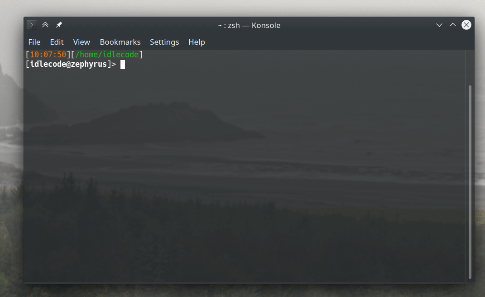

# Killtimer - do more working less!
This utility helps limit the amount of time devoted to work by keeping track of clearly defined work periods.
It's like a timer which cannot be stopped but will kill the passed command forcing the user to finish the job.

This may sound counterintuitive, but a lot of studies show that limiting time for a task forces the person to use the time more effectively.

## Features
- CLI interface
- Three configurable effort levels:
  - Minimal
  - Work
  - Overtime
- Keep track of user-provided command and kill it if it has been running too long (after overtime)
- Utilizes desktop notifications to inform users about the finished period
- Plays a notification sound when minimal effort/work period is done - optionally a custom sound file
  (sounds are played by the desktop's notification server, so they depend on its sound support)
- Allow storing amount of work done as CSV file for further analysis 

## Install
Killtimer requires Python 3.11 or newer. The recommended way to install it is with [pipx](https://pipx.pypa.io/),
which puts the `killtimer` and `killtimer-stats` commands on your `PATH` in an isolated environment:
```console
$ pipx install killtimer
```

To upgrade to the newest version later:
```console
$ pipx upgrade killtimer
```

## Usage



```usage
usage: killtimer [options] [--] [command [arguments ...]]

Close application when time runs out

positional arguments:
  command               Executable (with arguments) to run

options:
  -h, --help            show this help message and exit
  -m, --minimal-effort duration
                        Minimal work duration (default: None)
  -w, --work duration   Proper work duration (default: 1:00:00)
  -o, --overtime duration
                        Overtime duration (default: None)
  -l, --log log_file    Log file where to store amount of work done (default:
                        None)
  -t, --title title     Title to display above progress bars and configuration
                        (default: None)
  -s, --sound sound_file
                        Sound file to play with the notification when minimal
                        effort or work period is reached (instead of the
                        default notification sound) (default: None)
```

When not given, the minimal effort defaults to 50% and the overtime to 25% of the work duration.

Killtimer options must come before the command - everything from the command name onwards
(including arguments that look like options, e.g. `blender --background`) is passed to the command.
Use `--` before the command if its name starts with a dash.
The command is started directly (not through a shell) with its arguments passed as given.
When the overtime runs out, it is sent `SIGTERM` together with any processes it started;
whatever is still running 5 seconds later is killed with `SIGKILL`.

Usually you would want to create alias in your `*rc` file like:
```shell
alias blender-work="killtimer -m 10m -w 1h -o 10m -t 'Creative work' -l /path/to/worklog.csv blender"
```